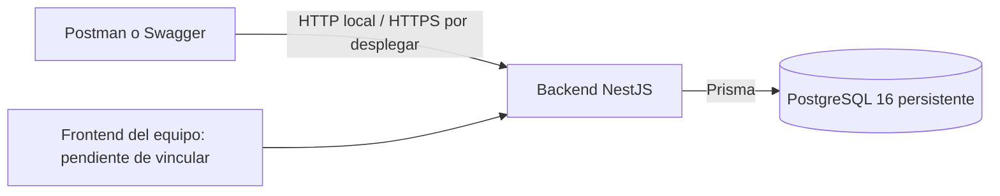

# Arquitectura

| Capa | Tecnología |
|---|---|
| Backend | Node.js 22, NestJS 10, TypeScript |
| Datos | Prisma 5, PostgreSQL 16 |
| API | REST JSON, Swagger |
| Pruebas | Jest, node:test, Newman |
| Ejecución | Docker Compose: db y backend |

## Estructura

- `backend/src`: módulos de dominio y servicios.
- `backend/prisma`: esquema, migraciones y semillas.
- `backend/scripts`: arranque, exportación de accesos y comprobaciones.
- `backend/test`: regresiones existentes.
- `postman`: una colección y un environment privado generado.
- `docs`: documentación y trazabilidad.

## Decisiones

| Decisión | Motivo |
|---|---|
| Sesión opaca en cookie HttpOnly y registro AuthSession | Identidad verificada en servidor, sin confiar en roles enviados por el cliente |
| Transacciones y bloqueos PostgreSQL | Evitar doble reserva, doble toma de comanda y stock inconsistente |
| Decimal para precios | Evitar errores de representación monetaria |
| Una base persistente por instalación | Conservar datos al reiniciar y no depender de una base temporal |
| Credenciales fuera de Git | Acceso reproducible sin publicar secretos |
