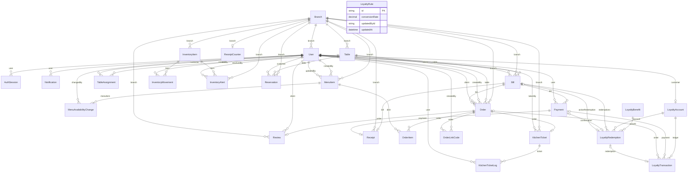

# Modelo de datos

Fuente: `backend/prisma/schema.prisma`.

Las relaciones opcionales permiten registros sin vínculo (por ejemplo, pedido para llevar sin mesa). El esquema Prisma es la referencia para nulabilidad y restricciones.

| Tabla | Función | Campos persistentes |
|---|---|---|
| Branch | Sucursal y horario | id, code, name, openingTime, closingTime |
| User | Cuenta, rol y perfil | id, email, passwordHash, role, branchId, isActive, firstName, lastName, phone, createdAt, updatedAt |
| AuthSession | Sesión opaca con caducidad | tokenHash, userId, createdAt, expiresAt |
| Notification | Aviso por evento y destinatario | id, userId, title, message, sourceModule, eventKey, relatedEntityId, readAt, createdAt |
| MenuItem | Platillo y precio por sucursal | id, branchId, name, normalizedName, description, category, price, isAvailable, createdById, updatedById, createdAt, updatedAt |
| MenuAvailabilityChange | Auditoría de disponibilidad | id, menuItemId, oldValue, newValue, changedById, createdAt |
| Table | Mesa, capacidad y estado | id, branchId, number, status, capacity |
| TableAssignment | Asignación temporal de cliente a mesa | id, tableId, customerId, validFrom, validTo |
| Order | Pedido, cliente y estado | id, orderNumber, branchId, tableId, createdById, clientId, type, status, total, createdAt, updatedAt, clientLinkedAt, pickedUpAt, pickedUpById, deliveredById, deliveredAt, billId |
| Review | Calificación de un pedido entregado | id, orderId, clientId, branchId, rating, comment, createdAt, updatedAt |
| Bill | Cuenta y totales | clientId, id, branchId, tableId, type, status, subtotal, discount, tax, total, createdAt, paidAt, redemptionId |
| Payment | Intento de pago simulado e idempotencia | id, billId, userId, idempotencyKey, status, amount, cardLast4, failureCode, createdAt, completedAt |
| ReceiptCounter | Secuencia de comprobantes por sucursal | branchId, nextNumber |
| Receipt | Comprobante y datos inmutables del cobro | id, billId, paymentId, clientId, branchId, number, sequence, subtotal, discountAmount, taxAmount, total, snapshot, cardLast4, issuedAt (columna createdAt) |
| OrderItem | Detalle y preparación del platillo | id, orderId, dishId, quantity, unitPrice, note, status, isReady, readyAt, readyById |
| KitchenTicket | Comanda y responsable | id, orderId, branchId, status, takenById, takenAt, readyAt, createdAt, updatedAt |
| KitchenTicketLog | Auditoría de acciones de cocina | id, ticketId, action, userId, createdAt |
| OrderLinkCode | Código de vinculación almacenado como hash | createdById, id, orderId, codeHash, expiresAt, usedAt, createdAt |
| InventoryItem | Existencias y mínimo de insumo | id, branchId, name, unit, minStock, currentStock |
| InventoryMovement | Entrada o salida auditada | id, itemId, quantity, type, reason, createdById, createdAt |
| InventoryAlert | Alerta y resolución de reposición | id, branchId, itemId, currentStock, minStock, status, createdAt, resolvedAt, resolvedByUserId |
| Reservation | Reserva de mesa por intervalo | id, branchId, tableId, customerId, date, startTime, endTime, partySize, status, createdAt, updatedAt |
| LoyaltyRule | Regla global de acumulación | id GLOBAL, conversionRate, updatedById, updatedAt |
| LoyaltyBenefit | Catálogo de beneficios | id, name, pointsRequired, discountValue, isActive, createdAt, updatedAt |
| LoyaltyAccount | Saldo confirmado por cliente | id, customerId, balance, createdAt, updatedAt |
| LoyaltyTransaction | Historial inmutable de puntos ganados/canjeados | id, accountId, type, points, paymentId, orderId, redemptionId, createdAt |
| LoyaltyRedemption | Reserva, confirmación o liberación de un canje | id, accountId, benefitId, billId, points, discountAmount, status, paymentId, createdAt, confirmedAt, releasedAt |

Los canjes PENDING reservan saldo sin descontarlo del saldo confirmado. El pago confirma el canje y escribe el débito; la liberación devuelve disponibilidad. El esquema incluye referencias opcionales y restricciones adicionales en migraciones SQL.
